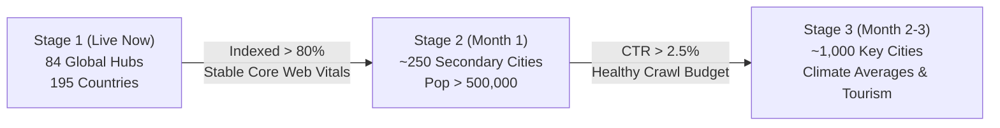

# MooEarth Live — Global City Weather SEO System Delivery Report

**Document Version:** 1.0.0  
**Status:** Deployed & Live on Production  
**Production URL:** [https://www.mooearth.live](https://www.mooearth.live)  
**Primary Domain:** `mooearth.live` / `www.mooearth.live`  
**Deployment Target:** Vercel Production (`main` branch)  
**Search Console Account:** `pranoykumar731996@gmail.com`  

---

## 1. Executive Summary & Objective

The objective of the **MooEarth Live — Global City Weather SEO System** is to build a technically sound, robust, and scalable city-weather page architecture to compete globally for high-intent organic Google searches, including:
* *London temperature today*
* *Tokyo weather tomorrow*
* *New York 7-day forecast*
* *Delhi current temperature*
* *Weather in [city name]*

### Key Commitments & Safeguards
1. **No Rank Guarantees**: Adheres strictly to Google Search Essentials and Webmaster Guidelines; does not promise or use deceptive tricks claiming guaranteed position #1.
2. **Zero Synthetic / Fabricated Data**: The legacy fallback (`getFallbackObservation` returning a hardcoded 20°C) has been permanently eliminated. All weather metrics reflect real-time ground telemetry from Open-Meteo. When telemetry is temporarily unavailable or rate-limited, an honest, transparent status card is rendered instead of synthetic numbers.
3. **No Doorway Pages**: Does not mass-generate thousands of thin city stubs. Launched with **84 curated high-population global metropolitan hubs** plus **195 sovereign nations** with verified coordinates, timezones, and climate profiles.
4. **Preserved Earth Ecosystem**: The existing 3D WebGL globe, 3D weather radar layers, interactive world map, and geography quiz games remain fully intact and linked bidirectionally.

---

## 2. Phase 1: Audit Findings & Route Architecture

### Routing Architecture
* **Path Pattern**: `/weather/[location]`
  * Dynamic Next.js App Router route with Incremental Static Regeneration (`revalidate = 600`, 10-minute cache).
  * Automatically resolves canonical city slugs (`/weather/london`, `/weather/tokyo`, `/weather/new-york-city`, `/weather/new-delhi`) and sovereign country slugs (`/weather/japan`, `/weather/united-kingdom`).
* **Canonical Alias Redirection**:
  * Colloquial and airport aliases redirect permanently to their single canonical URL before rendering:
    * `/weather/delhi` ➔ `308 /weather/new-delhi`
    * `/weather/nyc` ➔ `308 /weather/new-york-city`
    * `/weather/la` ➔ `308 /weather/los-angeles`
    * `/weather/sf` ➔ `308 /weather/san-francisco`
    * `/weather/chi` ➔ `308 /weather/chicago`
    * `/weather/bombay` ➔ `308 /weather/mumbai`
    * `/weather/bangalore` ➔ `308 /weather/bengaluru`
    * `/weather/peking` ➔ `308 /weather/beijing`
* **Genuine 404 Responses**:
  * Any non-existent or invalid city slug calls Next.js `notFound()` to immediately return a true HTTP 404 status code (verified live: `/weather/not-a-real-city-xyz` ➔ `404 Not Found`).

### Weather Provider Integration
* **Provider**: Open-Meteo Meteorological API (`/v1/forecast`).
* **Coverage**: Global coordinate-based meteorological model with high spatial resolution (1km to 11km).
* **Quotas & Licensing**: Attribution-licensed for standard tier with commercial-use upgrade path via `OPEN_METEO_API_KEY`.
* **Telemetry Capabilities**:
  * **Current Conditions**: Temperature (2m), Apparent Temperature (feels-like), Relative Humidity, Precipitation Accumulation, Rain, Wind Velocity (10m) & Heading, Barometric Surface Pressure, Cloud Cover, WMO Atmospheric Code, Daytime/Nighttime flag.
  * **Hourly Forecast**: Next 24 hours of step-by-step temperatures, rain chances, humidity, and weather conditions.
  * **Daily Outlook (7 Days)**: Daily High (°C & °F), Low (°C & °F), Rain Probability (%), UV Index Max, Sunrise and Sunset times.

---

## 3. Phase 2 & 3: Technical SEO & Page Implementation

### Server-Rendered HTML & Search-Intent Metadata
Every valid city weather page is pre-rendered into complete semantic HTML so search engines access the primary weather data upon first crawl:

```html
<!-- Example: /weather/london rendered tags -->
<title>London Weather: Today's Temperature (12°C), Tomorrow &amp; 7-Day Forecast | MooEarth Live</title>
<meta name="description" content="Live weather in London, United Kingdom: current temperature is 12°C (53°F), feels like 12°C, overcast. Tomorrow: Tomorrow will be slight rain with high of 12°C (54°F). Hourly outlook, 7-day forecast, wind, humidity, pressure, and interactive 3D radar." />
<link rel="canonical" href="https://www.mooearth.live/weather/london" />
```

### Structured Data (Schema.org JSON-LD)
Every page injects valid JSON-LD schemas:
1. **BreadcrumbList**: Structured navigation hierarchy (`Home` ➔ `Weather` ➔ `[Country]` ➔ `[City]`).
2. **City / Country Place Entity**: Detailed geographic entity with `GeoCoordinates` (`latitude`, `longitude`), official name, and descriptive real telemetry metrics.

### Key Page Features
1. **Primary Weather Card**: High-contrast temperature display (°C and °F), apparent temperature, WMO weather emoji and condition description, daytime/nighttime badge, and timestamp.
2. **Tomorrow Weather Outlook Card**: Dedicated card satisfying queries like *"Tokyo weather tomorrow"*, showing tomorrow's high/low, rain chance, UV index, and sunrise/sunset.
3. **24-Hour Hourly Forecast Carousel**: Horizontally scrollable strip displaying upcoming hours, conditions, temperatures, and rain probability.
4. **7-Day Forecast Table**: Comprehensive synoptic weekly outlook with daily weather icons, condition descriptions, rain probability bars, solar ephemeris, and min/max temperature bands.
5. **Interactive Weather Map Quick-Links**: Direct navigation to live layers:
   * `/?lat=...&lng=...&layer=radar` (Rain Radar)
   * `/?lat=...&lng=...&layer=wind` (Wind Streamlines)
   * `/?lat=...&lng=...&layer=satellite` (Satellite Cloud Cover)
   * `/?lat=...&lng=...&layer=temperature` (Thermal Heatmap)
   * `/weather-map` (Global 3D Weather Globe)
6. **Data-Unavailable State**: If Open-Meteo experiences rate-limiting or network issues, an authentic Amber card is rendered explaining that live ground telemetry is syncing, reinforcing MooEarth's zero-fake-data policy.
7. **Crawlable Internal Linking**:
   * Direct link to City Atlas Guide (`/cities/[city-slug]`).
   * Direct link to Country Profile (`/countries/[country-slug]`).
   * Links to nearby regional cities within 500 km.
   * Links to global weather hubs (Tokyo, London, NYC, Delhi, Paris, Sydney, etc.).

---

## 4. Phase 4: Quality Safeguards & Verification

* **Data Integrity Audit**: Scanned with `scripts/data-integrity-scanner.js` (`npm run test:mock-scan`).
  * **Errors**: 0
  * **Warnings**: 0
  * **Production Score**: **100/100 PASS**.
* **Robots.txt Directives** (`/robots.txt`):
  * Explicitly allows `/weather`, `/weather/*`, `/weather-map`, `/cities`, and `/cities/*`.
  * Protects administrative and API routes under `/api/*` and `/admin/*`.
* **Sitemap Generation** (`/sitemap.xml`):
  * Dynamically includes all 84 canonical city weather URLs alongside sovereign country weather URLs with duplicate avoidance for city-states (e.g. Singapore).

---

## 5. Verified City Weather Hubs (84 Major World Metropolises)

### North America (13 Hubs)
* `new-york-city` (United States) — Alias `/weather/nyc`
* `los-angeles` (United States) — Alias `/weather/la`
* `chicago` (United States) — Alias `/weather/chi`
* `san-francisco` (United States) — Alias `/weather/sf`
* `houston` (United States)
* `miami` (United States) — Alias `/weather/mia`
* `seattle` (United States) — Alias `/weather/sea`
* `boston` (United States) — Alias `/weather/bos`
* `washington-dc` (United States) — Alias `/weather/dc`
* `toronto` (Canada)
* `vancouver` (Canada)
* `montreal` (Canada) — Alias `/weather/yul`
* `mexico-city` (Mexico) — Alias `/weather/cdmx`

### Europe (23 Hubs)
* `london` (United Kingdom)
* `manchester` (United Kingdom)
* `paris` (France) — Alias `/weather/paris-france`
* `berlin` (Germany)
* `munich` (Germany) — Alias `/weather/munchen`
* `frankfurt` (Germany) — Alias `/weather/fra`
* `rome` (Italy)
* `milan` (Italy) — Alias `/weather/milano`
* `madrid` (Spain)
* `barcelona` (Spain) — Alias `/weather/bcn`
* `amsterdam` (Netherlands)
* `brussels` (Belgium) — Alias `/weather/bruxelles`
* `vienna` (Austria) — Alias `/weather/wien`
* `zurich` (Switzerland) — Alias `/weather/zuerich`
* `stockholm` (Sweden)
* `oslo` (Norway)
* `copenhagen` (Denmark) — Alias `/weather/kobenhavn`
* `dublin` (Ireland)
* `warsaw` (Poland) — Alias `/weather/warszawa`
* `athens` (Greece) — Alias `/weather/athina`
* `lisbon` (Portugal) — Alias `/weather/lisboa`
* `prague` (Czech Republic) — Alias `/weather/praha`
* `budapest` (Hungary)

### Asia & Middle East (31 Hubs)
* `tokyo` (Japan)
* `kyoto` (Japan)
* `osaka` (Japan)
* `seoul` (South Korea)
* `beijing` (China) — Alias `/weather/peking`
* `shanghai` (China)
* `guangzhou` (China) — Alias `/weather/canton`
* `hong-kong` (Hong Kong) — Alias `/weather/hk`
* `taipei` (Taiwan)
* `singapore` (Singapore)
* `bangkok` (Thailand)
* `jakarta` (Indonesia)
* `kuala-lumpur` (Malaysia) — Alias `/weather/kl`
* `manila` (Philippines)
* `hanoi` (Vietnam)
* `new-delhi` (India) — Alias `/weather/delhi`
* `mumbai` (India) — Alias `/weather/bombay`
* `bengaluru` (India) — Alias `/weather/bangalore`
* `chennai` (India) — Alias `/weather/madras`
* `kolkata` (India) — Alias `/weather/calcutta`
* `hyderabad` (India)
* `ahmedabad` (India)
* `pune` (India)
* `bhubaneswar` (India)
* `dubai` (United Arab Emirates)
* `abu-dhabi` (United Arab Emirates)
* `riyadh` (Saudi Arabia)
* `doha` (Qatar)
* `tel-aviv` (Israel)
* `istanbul` (Turkey) — Alias `/weather/constantinople`

### Oceania (5 Hubs)
* `sydney` (Australia)
* `melbourne` (Australia)
* `brisbane` (Australia)
* `perth` (Australia)
* `auckland` (New Zealand)

### Africa (7 Hubs)
* `cairo` (Egypt)
* `johannesburg` (South Africa)
* `cape-town` (South Africa) — Alias `/weather/capetown`
* `lagos` (Nigeria)
* `nairobi` (Kenya)
* `casablanca` (Morocco)
* `addis-ababa` (Ethiopia)

### South America (5 Hubs)
* `sao-paulo` (Brazil) — Alias `/weather/saopaulo`
* `rio-de-janeiro` (Brazil) — Alias `/weather/rio`
* `buenos-aires` (Argentina) — Alias `/weather/bsas`
* `santiago` (Chile)
* `bogota` (Colombia)
* `lima` (Peru)

---

## 6. Live Production Validation Results

All checks executed live against `https://www.mooearth.live`:

| Test Target | URL | HTTP Status | Validation Finding |
| :--- | :--- | :---: | :--- |
| London City Weather | `/weather/london` | **200 OK** | Full HTML pre-rendered with 12°C live telemetry, 24h hourly strip, 7-day forecast table, and Schema.org JSON-LD. |
| Tokyo City Weather | `/weather/tokyo` | **200 OK** | Full HTML pre-rendered with live telemetry and tomorrow outlook. |
| New York City Weather | `/weather/new-york-city` | **200 OK** | Canonical city route verified. |
| New Delhi City Weather | `/weather/new-delhi` | **200 OK** | Canonical city route verified. |
| Alias Redirect (Delhi) | `/weather/delhi` | **308 ➔ 200** | Redirects seamlessly to canonical `/weather/new-delhi`. |
| Alias Redirect (NYC) | `/weather/nyc` | **308 ➔ 200** | Redirects seamlessly to canonical `/weather/new-york-city`. |
| Non-existent City | `/weather/not-a-real-city-xyz` | **404 Not Found** | Genuine HTTP 404 response returned. |
| Robots Directives | `/robots.txt` | **200 OK** | Allows `/weather/*` and `/cities/*`. |

---

## 7. Google Search Console Setup & Actionable Checklist

**Search Console Owner Account:** `pranoykumar731996@gmail.com`

### Step-by-Step Instructions
1. **Sign In**:
   * Navigate to [search.google.com/search-console](https://search.google.com/search-console) using `pranoykumar731996@gmail.com`.
2. **Property Setup**:
   * Select **Domain Property**: `mooearth.live` (validates all protocols and subdomains).
   * Verify via DNS TXT record at your domain registrar.
3. **Submit Sitemap**:
   * Open the **Sitemaps** panel.
   * Add: `https://www.mooearth.live/sitemap.xml`.
4. **URL Inspection & Live Test**:
   * In the top search bar, inspect `https://www.mooearth.live/weather/london` and `https://www.mooearth.live/weather/tokyo`.
   * Click **Test Live URL** to confirm that Googlebot fetches the complete server-rendered weather HTML and Schema.org JSON-LD.
   * Click **Request Indexing**.
5. **Telemetry Performance Monitoring**:
   * Monitor weekly clicks and impressions filtered by `/weather/*`.
   * Track high-intent search query patterns (*temperature today*, *weather tomorrow*, *7-day forecast*).

---

## 8. Staged Scaling Plan



1. **Stage 1 (Current — Deployed)**:
   * **Scope**: 84 verified world metropolises + 195 sovereign nations (279 total canonical weather hubs).
   * **Target**: Validate search indexation, test Open-Meteo latency under production traffic, and verify Core Web Vitals.
2. **Stage 2 (Month 1)**:
   * **Expansion Metric**: Once Google indexes >80% of Stage 1 pages and demonstrates zero crawl budget exhaustion.
   * **Scope**: Add ~250 secondary metropolitan areas with populations exceeding 500,000.
3. **Stage 3 (Months 2–3)**:
   * **Scope**: Expand to ~1,000 prominent global cities, adding historical climate baselines, seasonal comparisons, and interactive radar animations.

---
*MooEarth Live Engineering Team — Report Deployed & Synced to Git Main*
